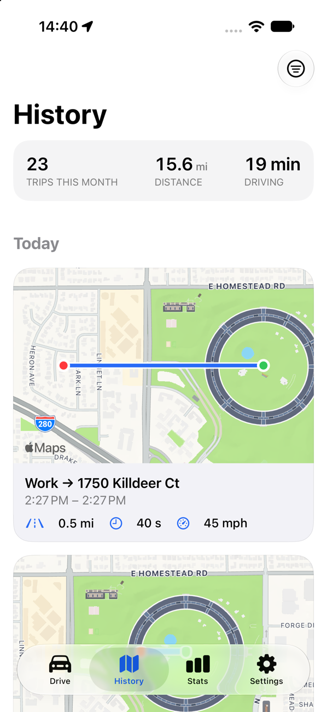
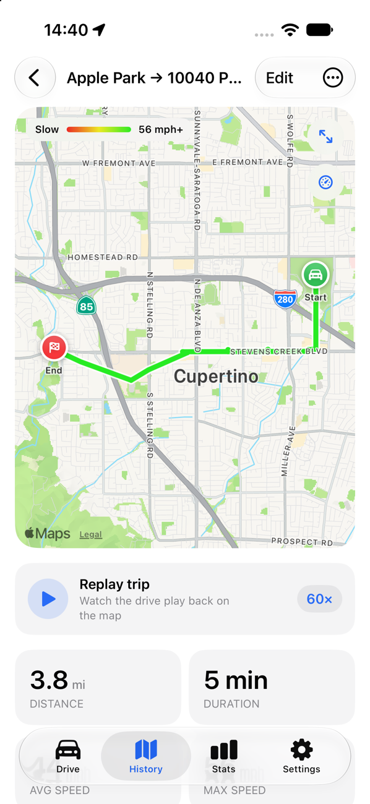
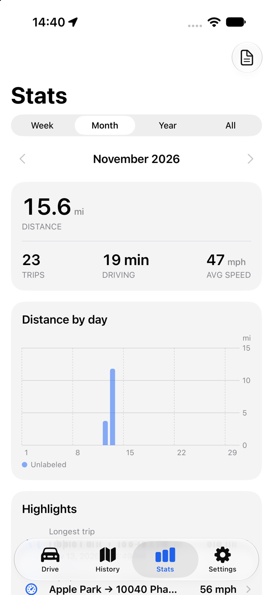

# Routak

Routak is an iPhone app that records your drives by itself. It notices when you start driving, saves the trip when you park, and keeps a searchable history with maps, stats and mileage logs. In English and Czech.

<p>
  
  
  
</p>

## Install with AltStore

1. Install [AltStore Classic](https://altstore.io) on your iPhone.
2. In AltStore, open **Sources**, tap **+** and add:

   ```
   https://raw.githubusercontent.com/8aty/Routak/main/altstore/source.json
   ```

3. Open the Routak source and tap **Get** (or **Free**).
4. Open Routak and allow location access **Always**, so drives are detected while the app is closed.

### Updates

AltStore checks the source for new versions. When one is out, Routak shows an **Update** button under **My Apps** (pull down to refresh). Your trips are kept.

### Good to know

- **Free Apple ID:** AltStore must refresh the app every 7 days, and a free account can have only 3 sideloaded apps at once. Routak's widgets live in an app extension, which uses one more App ID; if AltStore says you've run out, let it install Routak without the extension (you lose the widgets and Lock Screen trip, everything else works).
- **iCloud sync** isn't available in AltStore builds: a personal Apple ID can't use iCloud. Trips stay on your iPhone. Use **Settings → Export & Import** to move them.
- Requires iOS 17 or later.

## Features

- Automatic trip detection and recording, ending when you park (red lights and traffic jams don't end a trip)
- Routes snapped to roads and colored by speed, with replay
- Labels (Commute, Work, Personal), notes, search and filters
- Home and Work places name your trips automatically
- Stats, a heatmap of where you drive, commute times
- Mileage log (PDF/CSV), fuel cost estimates
- Export GPX, KML or CSV; import GPX
- Lock Screen Live Activity, widgets, Shortcuts actions (e.g. start a trip when CarPlay or your car's Bluetooth connects)
- "Eyes on the road" reminder while the car is moving

## Releasing a new version

1. Push your changes to `main`.
2. On GitHub, open **Actions → Release → Run workflow**, enter a version higher than the last one (e.g. `1.1.0`) and a short "what's new".

The workflow builds `Routak.ipa`, publishes it as a GitHub Release and adds it to `altstore/source.json`. AltStore then offers the update. Pushing a tag (`git tag -a v1.1.0 -m "What's new" && git push origin v1.1.0`) does the same.

To build the IPA locally: `scripts/build-ipa.sh 1.1.0 42`.
